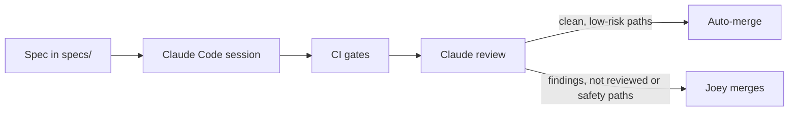

# Cadent

A self-hosted running coach that keeps your training steady. Cadent syncs your Garmin data, shows
today's planned run each morning, compares every run to the plan, and checks every plan against
injury-prevention rules before you follow it. AI analysis is optional and runs on **your own** AI
subscription through an MCP server: the app itself makes no AI calls and costs nothing to run beyond hosting.

> Status: week 1 of 8. Built in the open toward a December 2026 release, and used daily for a
> half-marathon build (Toronto, May 2, 2027).

## Why it's built this way

- **Plans are checked, never trusted.** One deterministic rules engine validates every plan,
  whether imported, generated or drafted by an AI. Rules are written test-first, with
  property-based tests, and real training plans as golden fixtures.
- **Plans stay consistent.** The app warns; it never edits your plan on its own.
- **AI on your terms.** An OAuth-protected MCP server exposes read-only tools, so Claude,
  ChatGPT or any MCP client can analyse your data without the app paying for tokens.
- **Boring, fast stack.** Python/FastAPI, Postgres, a static React app, Docker Compose. See
  [the decisions](docs/decisions/) for the reasoning behind each choice.

## Stack

Python 3.12 · FastAPI · Pydantic · SQLAlchemy · PostgreSQL · TypeScript · React · Vite ·
Tailwind · Docker Compose · Caddy · GitHub Actions · pytest + Hypothesis · Vitest · Playwright

## Quality gates

Every change passes `make check`, enforced locally by pre-commit and a Claude Code Stop hook, and in CI:

| Gate | Tool |
| --- | --- |
| Format and lint | Ruff, ESLint |
| Strict types | Pyright (strict), TypeScript (strict) |
| Architecture | import-linter: `core` never imports I/O |
| Dead code | vulture, knip |
| Duplication | jscpd |
| Tests | pytest, Hypothesis, Vitest, 90% branch coverage on `core` |
| Protected safety tests | test-count floor, no skips, CODEOWNERS |

AI review runs after the deterministic gates. Its verdict only decides whether a low-risk PR can
merge on its own (see below).

## How this was built

Cadent is built with Claude Code as the main pair programmer. The repo carries the guardrails, so
the same rules apply whether a change comes from a local session or an `@claude` comment on GitHub.



- **Spec first.** The `/write-spec` skill interviews me and writes `specs/<feature>.md` (files
  touched, out of scope, acceptance tests) before any code. Planning happens in a fresh session.
- **Rules in [CLAUDE.md](CLAUDE.md).** The rules-engine tests are the spec and never get weakened, every plan
  goes through `cadent_core.rules.validate`, no new dependency or structural choice without an ADR.
- **Hooks enforce what prose can't.** A PreToolUse hook ([protect_files.py](.claude/hooks/protect_files.py))
  blocks edits to golden fixtures, CODEOWNERS and the test-count floor, and any edit to
  `core/tests/` that removes a test or assertion or adds a skip. A Stop hook runs `make check`
  and refuses to let a session finish while it fails.
- **Subagents with one job each** ([.claude/agents/](.claude/agents/)): `test-writer` writes tests from the spec, not
  the code; `code-reviewer` reviews a diff in a fresh context; `safety-auditor` looks for ways an
  unsafe plan could get through; `simplifier` only proposes deletions; `ui-critic` checks screens
  at phone width.
- **CI decides, not the model.** [ci.yml](.github/workflows/ci.yml) runs the gates above, plus a guard that fails if any
  protected test is skipped or the rules-engine test count drops below `core/tests/MIN_TEST_COUNT`.
- **Claude review with a verdict.** Once CI passes, a read-only review job runs `code-reviewer` (and
  `safety-auditor` on safety paths), posts inline comments and returns `clean`, `findings` or
  `not-reviewed`. Anything that isn't a successful zero-finding run counts as not reviewed.
- **Split merge gate ([ADR 011](docs/decisions/011-auto-merge-low-risk.md)).** A PR that only touches `web/`, `api/`, `docs/`, `specs/` or
  the README auto-merges on a `clean` verdict, pinned to the reviewed commit. Rules, protected
  tests, ADRs, dependencies, workflows and `.claude/` always wait for me, as does any PR labelled
  `hold`. Local Claude sessions are denied `gh pr merge` outright.

## Run it

```bash
cp .env.example .env      # set a password and your domain
make up                   # builds the web app and starts db, api and Caddy
```

Development: `uv sync`, `cd web && pnpm install`, then `make dev`.

## Project layout

```
core/    pure domain logic: rules engine, metrics (no I/O)
api/     FastAPI: REST, later MCP and OAuth
web/     Vite + React PWA
docs/    decisions (ADRs), patterns, glossary
specs/   one spec per feature
```

## Disclaimer

Cadent is a planning tool, not medical advice. See a doctor before starting a new training
program, and stop if something hurts.

## License

MIT
